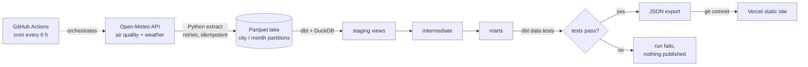

# Bishkek Air

**Live dashboard: LIVE_URL**

Every winter Bishkek disappears under a layer of smog, and the mountains you can
see from any street in summer vanish. This project tracks how bad it is, hour by
hour, for 8 cities in Central Asia since January 2023. It is built as a
production-style data pipeline that runs itself.


## What it answers

- How polluted is the air right now, and what is the forecast for the next days?
- How many days a year are above the WHO limit (15 µg/m³ daily PM2.5)?
- At what hour and in which month is the air cleanest?
- How much does temperature (coal heating) and wind drive pollution?
- Is each heating season getting better or worse?
- How does Bishkek compare with Tokmok, Osh, Almaty and Tashkent?

## Architecture



| Layer | Tool | What it does |
|---|---|---|
| Orchestration | GitHub Actions (cron, every 6 h) | Runs the pipeline, persists state, publishes results |
| Extract | Python, `requests`, `pyarrow` | Pulls hourly data for 8 cities × 12 variables, with exponential backoff |
| Storage | Parquet (zstd), DuckDB | Raw lake partitioned by `source / city / month`; warehouse rebuilt each run |
| Transform | dbt-core + dbt-duckdb | 12 models in staging → intermediate → marts layers |
| Quality | dbt data tests, pytest | Uniqueness, ranges, relationships, freshness, completeness; unit tests for extract logic |
| Serving | Static HTML/JS on Vercel | No framework, no chart library; every chart is hand-drawn SVG |

## Design decisions

**Idempotent incremental loads.** The lake stores one Parquet file per city per
month. A run fetches missing months plus a trailing window of 2 months (the
upstream model revises recent values) and overwrites those files atomically.
Re-running a load never creates duplicates, and the staging layer also
deduplicates by `(city_id, ts_utc)` keeping the latest ingestion.

**Few API calls.** Contiguous months are collapsed into ranges of up to a year,
so the full 2023+ backfill is 64 requests and a normal run is 16.

**Stateless compute, persistent lake.** The runner is ephemeral. The lake lives
on a separate `data-lake` branch that is force-pushed as a single commit, so the
repository history does not grow with every run. The DuckDB warehouse is rebuilt
from the lake each time, which takes seconds.

**Tests gate publishing.** `dbt build` runs models and tests together. If an
error-level test fails (duplicate keys, impossible values, a city with no data),
the job stops before the export step and the live site keeps the last good data.
Freshness is a warning-level test.

**Offline CI.** `pipeline/synthetic.py` is a fake API that returns payloads with
exactly the same shape as Open-Meteo. CI runs the entire pipeline against it on
every pull request, without network access. Synthetic data is written to a
separate folder and is never published.

## Data model

```
seeds/cities                      8 cities, coordinates, UTC offset
staging/stg_air_quality           hourly PM2.5, PM10, NO2, SO2, CO, O3, US AQI
staging/stg_weather               hourly temperature, humidity, wind, precipitation, pressure
staging/stg_air_quality_forecast  latest forecast snapshot
intermediate/int_air_hourly       observed hours + weather + local time + AQI category
marts/fct_air_hourly              hourly fact table
marts/mart_city_daily             daily means, WHO exceedance flag (days with ≥18 h of data)
marts/mart_city_monthly           monthly aggregates
marts/mart_hourly_profile         month × hour-of-day profile
marts/mart_weather_effect         PM2.5 by temperature and wind bins
marts/mart_heating_seasons        November–March season comparison
marts/mart_forecast_daily         next days forecast
marts/mart_city_summary           headline metrics per city
```

## Run it locally

```bash
pip install -r requirements.txt
export LAKE_DIR=$PWD/data/lake WAREHOUSE_PATH=$PWD/data/warehouse.duckdb

python -m pipeline.run all              # real data from Open-Meteo
python -m pipeline.run all --synthetic  # offline, fake data
python -m pytest -q tests

cd web && python -m http.server 8000    # open http://localhost:8000
                                        # (add ?demo to view synthetic data)
```

## Limitations

The values come from the CAMS global atmospheric model (about 40 km grid),
served by [Open-Meteo](https://open-meteo.com/). They describe a city as a
whole, not a single street, and they smooth out local peaks near heavy sources.
Ground sensors in Bishkek often report higher numbers on the worst winter
evenings.

## Author

Aba Bekrahoon Umurjanov — [LinkedIn](https://www.linkedin.com/in/aba-bekrahoon-umurjanov-183b39352) · [GitHub](https://github.com/bekrahoon)
